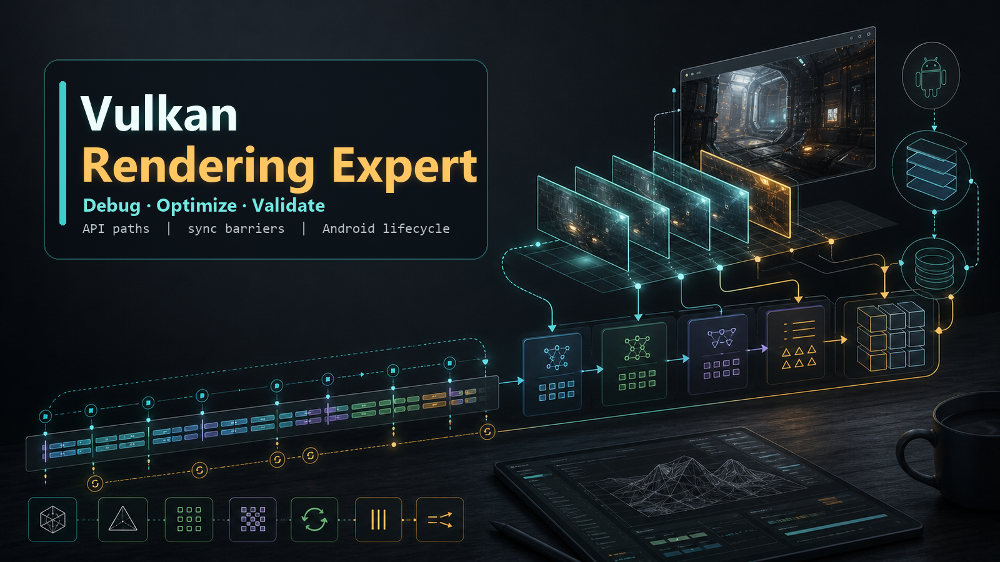

# Vulkan Rendering Expert Skill

English | [中文](https://github.com/oahc09/vulkan-rendering-expert-skill/blob/main/README.md)



This is a Vulkan rendering engineering expert skill package. It is not a Vulkan beginner tutorial, but a runtime knowledge base prepared for real rendering engineering tasks: when handling Vulkan design, implementation, debugging, optimization, and verification problems, it organizes judgments, citation rules, API details, debugging paths, and regression verification along engineering pipelines.

## Use Cases

- Designing Vulkan rendering pipelines, Render Passes, Dynamic Rendering, Render Graphs, or RHI abstractions.
- Implementing or modifying Descriptor, Pipeline, Command Buffer, Buffer/Image, Swapchain, synchronization, and resource lifecycle code.
- Debugging black screens, flickering, crashes, GPU hangs, device lost, Validation Errors, image layouts, descriptor binding, and similar issues.
- Analyzing mobile Vulkan performance bottlenecks, including bandwidth, fullscreen passes, barriers, descriptor updates, and pipeline creation stutter.
- Handling Android Vulkan `ANativeWindow`, Surface lifecycle, pause/resume, orientation changes, and swapchain recreation.
- Distinguishing between specification facts, engineering judgment, and items requiring lookup when API details are uncertain.
- Analyzing real Vulkan / graphics-engine repositories with `[CODE]` evidence, an Architecture Map, source-level change impact, and a coding-agent implementation handoff.

## Skill Structure

```text
.
├── SKILL.md                 # Skill entry: triggers, loading order, and output rules
├── agents/                  # Optional tool or platform integration configs
├── assets/                  # Image assets used by README and release pages
└── references/              # Vulkan expert knowledge base, progressively loaded by task
```

`references/` is split into 8 modules by responsibility:

| Module | Purpose |
|---|---|
| `00_expert_entry` | Role, hard rules, task classification, output formats, debugging/performance priorities |
| `01_source_map_and_api_manual_strategy` | Source tiers, citation rules, API card writing strategy |
| `02_core_mental_model` | Vulkan object chains, frame lifecycle, resource lifecycle, synchronization model, engine subsystem architecture and architecture decisions |
| `03_api_manual` | API cards, lifecycle index, error index, and Vulkan API details |
| `04_debug_playbooks` | Playbooks for black screens, flickering, crashes, Validation Errors, synchronization, and performance |
| `05_workflows` | Renderer, Pass, Compute, Android integration, resource management, and optimization workflows |
| `06_cases` | Real engineering cases, misdiagnosis retrospectives, root causes, fixes, and distilled lessons |
| `07_integration_pack` | Module dependencies, task routing, retrieval policy, and token usage rules |

## Core Capabilities

This skill requires output to always provide actionable Vulkan paths rather than stopping at conceptual explanations:

1. Lead with the conclusion and the highest-priority judgment.
2. Provide the Vulkan object chain, key APIs, resource states, layouts, or synchronization relationships.
3. Flag high-risk points such as descriptors, pipelines, command buffers, image layouts, object lifetimes, and the Android lifecycle.
4. Give the minimal verification approach, e.g. Validation Layer, RenderDoc, AGI, logcat, traces, counters, or targeted asserts.
5. Explicitly require looking up the Vulkan Spec, Registry, official samples, or platform docs when API details are uncertain.

## v1.0.11: Mobile Vulkan Evolution (2026-11-01)

Adds mobile profiling and sustained-performance contracts, resource-level GPU fault evidence, tile-aware rendering and external-resource interoperability, and optional neural graphics integration decisions. Capability checks and standard fallbacks remain mandatory; no required framework migration or blanket increase of the minimum device API.

Twelve new mobile scenarios are separate from the existing sixteen and the frozen twelve-case token target. Documentation/static checks are not Live-model, actual-host or native-device acceptance; unexecuted gates remain unverified.

## v1.0.10: Consistency and Release Verification (2026-11-01)

Aligns frame-loop summaries, failure paths and synchronization API cards while preserving the eight modules and minimal startup contract. Historical behavior answers are archived in the tests repository with a byte hash. Release checks use the actual whitelist manifest and an explicit candidate SHA, not the entire Git tree count.

This is a documentation/static-correctness candidate. Real 16-case Live runs, host discovery/loading and token reduction remain unverified; historical PASS or mocks are not acceptance evidence.

## v1.0.9: Lightweight Entry (2026-10-17)

Startup reads all 19 hard rules and only the routing-entry section of the single routing authority, then the matching sections. Templates, accuracy rules and retrieval protocols load when needed; G1-G6 verification remains mandatory before completion claims. All 8 modules, triggers, host configuration, Evidence Map and Architecture Map requirements remain intact.

Stable section anchors and whole-file fallbacks are documented in [Retrieval Policy](references/07_integration_pack/retrieval_policy.md#section-read-contract); the [rule migration map](references/00_expert_entry/README.md#rule-migration-map) traces the old entry rules. A 30% reduction in actual model tokens is a measurement target, not a verified result; static size changes do not establish live behavior or quality parity.

## Installation & Usage

This skill follows the Agent Skills specification: the repository root is the skill directory, `SKILL.md` is the entry point, and `references/` is loaded on demand.

**Claude Code**

```bash
git clone https://github.com/oahc09/vulkan-rendering-expert-skill ~/.claude/skills/vulkan-rendering-expert-skill
```

Once placed in the skills directory, describing a Vulkan problem triggers it automatically; you can also explicitly say "use vulkan-rendering-expert-skill".

**TraeCode / Trae**

Add this repository directory as a local skill in skill management, or install it from the skill marketplace.

**Other Agent Skills-compatible hosts** (Cursor, VS Code extensions, etc.)

Any host that reads the `SKILL.md` frontmatter and loads `references/` files per its instructions works. If the host has no skill mechanism, paste the full `SKILL.md` as a system prompt — the skill runs in degraded mode. Supply the required hard rules and matching reference sections as directed; automatic loading is unavailable, and pasting the entry alone does not establish full execution.

## Example Prompts

The following prompts are ready to copy; each is labeled with the modules it triggers:

1. `Android Vulkan black screen after pause/resume — give the object chain, most likely causes, and verification steps.` (debug playbook + Android case)
2. `vkCreateGraphicsPipelines failed with a VUID error — decode this Validation message: <paste it>` (validation decode playbook)
3. `GPU frame time is 22ms on a Xiaomi 13, dominated by fullscreen post-processing — how do I optimize it?` (performance playbook + optimization workflow)
4. `Build a minimal Vulkan renderer from scratch: validation-clean, resize-safe.` (renderer workflow + architecture decisions)
5. `With thousands of materials, descriptor set creation is slow — should I go bindless? Give me a decision analysis.` (architecture decision framework + bindless case)
6. `Hand-written barriers across 8 passes are getting unmaintainable — evaluate adopting a RenderGraph.` (architecture decision + RenderGraph case)
7. `How should I choose srcStageMask for vkCmdPipelineBarrier2?` (API card)
8. `Any real-world cases of crashes caused by swapchain recreation?` (case index)
9. `Diagnose this existing repository's Vulkan architecture first, then assess the source-level impact of upgrading to Vulkan 1.3. Do not give generic advice.` (project diagnosis + regression reasoning)

Attaching key information yields the most accurate answers — see the per-task-type question templates in section R2 of `references/00_expert_entry/progressive_retrieval.md`.

## Getting Started

- **Just ask (recommended)**: no files to read first — the skill routes by symptom/intent to the matching playbook, workflow, or case.
- **See the knowledge map**: read `references/README.md` and `references/MODULE_SUMMARY.md` for the division of labor across the 8 modules.
- **Deep dive**: read modules in order `00` → `07`; start with `04_debug_playbooks/` for debugging, `05_workflows/` for implementation, and `02_core_mental_model/engine_architecture.md` for architecture, and `05_workflows/01_renderer_setup/project_diagnosis.md` for real-repository diagnosis.


## v1.0.12 — Android System Rendering

v1.0.12 extends Android multi-instance/surface ownership, media-frame leases and synchronization, and color/HDR/alpha output contracts. No runtime knowledge files are added; the 200-file budget and startup remain unchanged. The paired tests repository adds 12 system cases (40 total). Isolated state/math fixtures are static evidence, not native Android, Live-model or device acceptance.

## v1.0.13 — Shader / Resource / GPU-driven Scale (2026-11-01)

Shader artifact/interface/hot reload, pipeline cache and bounded build scheduling, streaming residency/budgets, GPU-driven fixed slots/Count, LOD/current-frame Hi-Z/particles/multi-view are delivered together. Runtime knowledge adds no files; the 8 modules, startup/trigger rules, MIT license and 200-file package ceiling remain.

The paired tests repository contains the exact plan, 24 new ENG13 paired-condition cases (64 total, original 40 frozen), source traceability and an original C++/GLSL Engine Scale Lab. Build, software Vulkan execution, Live model/host and Android MobileScale are separate evidence layers. This candidate is not an automatically published release and does not claim mobile performance from software Vulkan.


## v1.0.14: Mobile Hybrid Lighting & Temporal Quality

Baseline shadows and reflection fallback; optional query-only AS engineering; temporal input/history contracts and non-neural filtering; evidence-based quality tiers. Keeps eight modules, zero new runtime knowledge files and the 200-file package ceiling. Paired tests register the frozen previous64 plus VIS14-01..20. Static, shader, software Vulkan, Live, host and Android evidence are independent; no unmeasured performance or power claim. See [conditional topic routing](references/07_integration_pack/task_routing_rules.md#hybrid-quality-topics).


## v1.0.15: Mobile Transparency, Volumetrics & Gaussian Rendering

Adds alpha/precision contracts, conditional WBOIT and observable overflow, single-layer refraction, bounded local volumes and soft particles, Gaussian data/projection/sort-cache/multi-set identity contracts, and coverage-based quality budgets. Reuses existing resource, lighting and history systems. Eight modules, minimal startup, zero new runtime knowledge paths and the 200-file package ceiling remain unchanged.

See [conditional topic routing](references/07_integration_pack/task_routing_rules.md#transparency-gaussian-topics). The paired tests repository owns 20 new TRAN15 cases, experiment source and raw evidence. Static, host/shader, Vulkan, Live/Host and mobile visual/performance results are separate; documentation does not establish device validation or power savings.

## v1.0.16: GPU simulation and dynamic geometry (unreleased)

Additive C1 fixed-tick/input/shared-world, C2 lightweight XPBD rope/regular-cloth, C3 bounded heightfield/one-way particle-event, and C4 kernel/synchronization/snapshot-retirement/mobile-budget contracts are available through the [existing workflow index](references/05_workflows/workflow_index.md). Eight modules, 197 knowledge files and the minimal startup remain unchanged; no runtime paths are added.

The candidate entry version is **1.0.16**. Skill v1.0.15 was merged in PR #11; publication of its paired test evidence remains pending. Transparent water/glass integration and sustained mobile acceptance remain unverified. This is candidate content, not a completed release. Documentation, host numerics, Shader compilation, Vulkan execution, Live/host behavior and sustained Android quality require separate evidence in the paired tests repository.

Change record (2026-11-07): extend eight existing authority anchors and short navigation; correct directly conflicting legacy advice on cross-workgroup barriers, atomic capability, Surface-independent compute and sampled-image layouts in place. No hard rules are moved. This candidate is not automatically merged or published.
